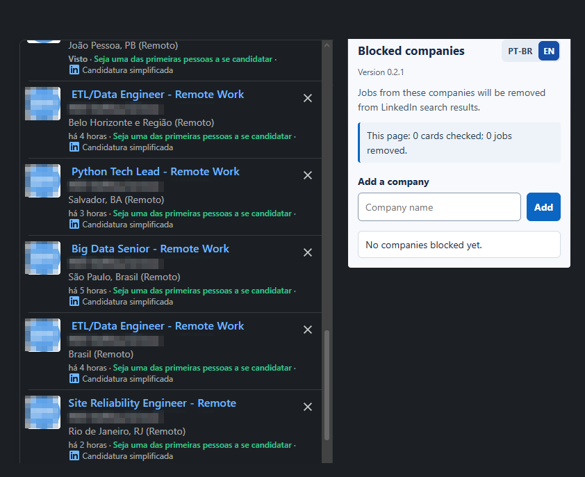
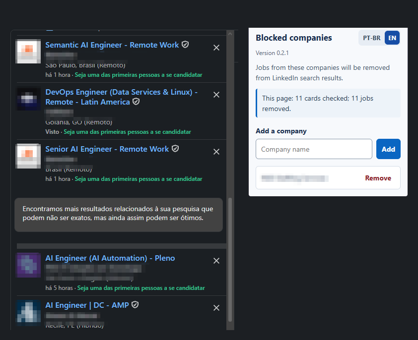

# LinkedIn Job Excludes

Extensão de navegador que filtra resultados de vagas do LinkedIn ocultando os cards das empresas que você adicionar à lista de bloqueio. Interface em português do Brasil e inglês. **Versão 0.2.1**.

> Projeto independente, sem afiliação com o LinkedIn.

## O que ela faz

- Permite manter uma lista de empresas bloqueadas entre diferentes buscas.
- Remove da lista visível os cards que correspondem às empresas cadastradas.
- Atualiza o filtro quando a lista muda e quando novos cards são carregados na página.
- Mostra quantos cards foram analisados e removidos.
- Oferece interface em português do Brasil e inglês.

A filtragem acontece no navegador, sobre os cards carregados na página. Ela não altera a busca ou os resultados armazenados pelo LinkedIn. Como o LinkedIn pode mudar a estrutura das páginas, a detecção pode precisar de atualizações futuras.

## Demonstração visual / Visual demo

As capturas mostram os resultados antes e depois de adicionar uma empresa. Nomes e logos de empresas foram pixelados para manter o foco no funcionamento da extensão.

**Antes / Before:** nenhuma empresa bloqueada; 0 vagas removidas.

**Depois / After:** empresa adicionada à lista; 11 vagas removidas nesta página.

## Instalação no Opera

### Pela loja Opera Add-ons

A extensão foi enviada para análise da Opera. Quando estiver aprovada, esta seção poderá receber o link da página oficial da loja.

### Instalação manual

1. Baixe o projeto pelo botão **Code → Download ZIP** e extraia o arquivo, ou clone este repositório.
2. No Opera, abra `opera://extensions`.
3. Ative o **Modo do desenvolvedor**.
4. Clique em **Carregar extensão descompactada** e selecione a pasta do projeto que contém `manifest.json`.
5. Abra uma busca de vagas em `linkedin.com/jobs`, clique no ícone da extensão e adicione uma empresa.

Para atualizar uma instalação manual, obtenha os arquivos novos, use **Recarregar** na página de extensões do Opera e atualize a aba de busca do LinkedIn.

## Como usar

1. Abra uma página de busca de vagas do LinkedIn.
2. Abra o popup da extensão e escolha **PT-BR** ou **EN**.
3. Digite o nome da empresa e clique em **Adicionar**.
4. Para voltar a ver as vagas, clique em **Remover** ao lado da empresa.

Os nomes não diferenciam maiúsculas de minúsculas; a correspondência também ignora acentos. Termos curtos ou genéricos podem corresponder a mais de uma empresa.

## Privacidade e permissões

A extensão usa o armazenamento do navegador para guardar a lista de empresas e o idioma escolhido. As estatísticas da página ficam no armazenamento local. Ela lê o texto dos cards de vagas exibidos no LinkedIn para aplicar o filtro e não envia esses dados a um servidor do projeto.

As permissões declaradas no manifesto permitem salvar essas preferências e executar o filtro nas páginas de vagas do LinkedIn. O código da extensão está incluído neste repositório para inspeção.

## Desenvolvimento

- `manifest.json`: nome, versão, permissões e pontos de entrada.
- `content.js`: encontra os cards, aplica o filtro e acompanha atualizações da página.
- `popup.html`, `popup.css` e `popup.js`: interface, idiomas e lista de empresas.
- `assets/`: ícones da extensão e arquivo vetorial de origem.

Ao publicar uma atualização da extensão, altere o número de versão em `manifest.json` e mantenha a documentação correspondente atualizada.

## Licença

Este projeto é distribuído sob a licença MIT. Consulte o arquivo [LICENSE](LICENSE).

---

## English

LinkedIn Job Excludes is a browser extension that filters LinkedIn job search results by removing visible cards from companies on your block list. The interface is available in Brazilian Portuguese and English. **Version 0.2.1**.

> This is an independent project and is not affiliated with LinkedIn.

### Features

- Keep a block list across different job searches.
- Remove matching job cards from the visible results list.
- Reapply the filter when the list changes or LinkedIn loads more cards.
- See how many cards were checked and removed.
- Use the interface in Brazilian Portuguese or English.

Filtering happens in your browser on cards currently loaded on the page. It does not change LinkedIn's search or its stored results. LinkedIn may change its page structure, which can require future updates to company detection.

### Install in Opera

**Opera Add-ons:** The extension has been submitted for review. The official store link can be added here after approval.

**Manual installation:** Download the repository using **Code → Download ZIP** and extract it, or clone the repository. Open `opera://extensions`, enable **Developer mode**, select **Load unpacked**, and choose the project folder containing `manifest.json`. Then open a LinkedIn jobs search, open the extension popup, and add a company.

To update a manual installation, get the latest project files, click **Reload** on the Opera extensions page, and refresh the LinkedIn jobs tab.

### Usage

1. Open a LinkedIn jobs search page.
2. Open the extension popup and choose **PT-BR** or **EN**.
3. Enter a company name and click **Add**.
4. Click **Remove** next to a company to show its jobs again.

Matching ignores case and accents. Short or generic terms may match more than one company.

### Privacy and permissions

The extension uses browser storage for the company list and language preference. Page statistics are stored locally. It reads text from LinkedIn job cards to apply the filter and does not send this data to a project server.

The permissions in the manifest allow the extension to save these preferences and run the filter on LinkedIn jobs pages. The extension code is included in this repository for inspection.

### License

This project is distributed under the MIT License. See [LICENSE](LICENSE).
